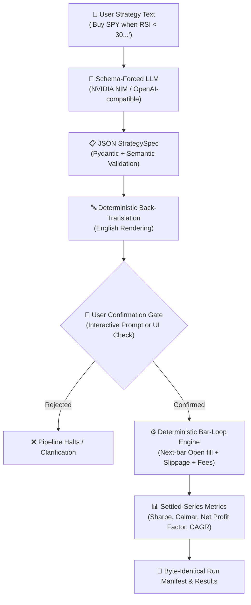

# ⚡ nlbt — Natural Language Backtester

<p align="center">
  <strong>Transform plain English trading strategies into deterministic, auditable backtests.</strong><br>
  <em>The LLM translates; it never calculates numbers or runs unverified code.</em>
</p>

<p align="center">
  
  
  
  
  
  
</p>

---

## 📖 What is `nlbt`?

Traditional "AI trading assistants" either generate raw Python code that can hallucinate or fail silently, or let LLMs fabricate math and performance figures.

**`nlbt` changes the paradigm:**
1. **Schema-Forced Translation:** The LLM *only* converts your English description into a strict, validated JSON specification (`StrategySpec`).
2. **Deterministic English Back-Translation:** The system renders the parsed JSON back into human-readable English so you can see *exactly* what was understood.
3. **Mandatory Confirmation Gate:** Backtests never execute without explicit user approval.
4. **Deterministic Bar-Loop Engine:** A vectorized Python simulation calculates all signals, order fills, fees, slippage, and performance metrics.
5. **Reproducible Manifest:** Every run outputs a cryptographically traceable, byte-identical JSON manifest.

> ⚠️ **Disclaimer:** Historical simulation only. This project produces research simulations, not trading predictions. Not financial or investment advice.

---

## 🏛️ Architecture & Flow



---

## ✨ Key Features

- **No Lookahead Bias:** Signals strictly evaluate on bar $t$; fills occur on bar $t+1$ Open.
- **Realistic Cost Model:** Configurable per-trade adverse slippage and fees (default: 5 bps fee + 5 bps slippage).
- **Intrabar Risk Controls:** Stop-loss, take-profit, ratcheted trailing stop, and maximum holding periods.
- **12 Built-in Indicators:** All backed by mathematical test oracles: `ADX`, `ATR`, `BBANDS`, `EMA`, `HIGHEST`, `LOWEST`, `MACD`, `OBV`, `ROC`, `RSI`, `SMA`, `STOCH`.
- **Differential Verification:** Validated trade-by-trade against `backtesting.py 0.6.6`.
- **100% Offline Demo Mode:** Includes pre-recorded fixture replays so you can test without an API key or internet access.

---

## 🚀 Quick Start

### 1. Prerequisites
- **Python 3.14+**
- **[uv](https://docs.astral.sh/uv/)** (recommended for ultra-fast package management) or standard `pip`.

### 2. Installation

Clone the repository and install dependencies:

```bash
git clone https://github.com/pratikjaiswalbussiness23-cloud/Backbat.git
cd Backbat/nlbt

# Using uv (fastest):
uv sync

# Or using standard pip:
pip install -e .
```

### 3. API Key Setup & Customization 🔑

`nlbt` gives users complete flexibility over LLM providers. You can use your own **NVIDIA NIM key**, swap to **OpenAI / Groq / DeepSeek / Ollama**, or run **100% offline** without any key.

#### A. Using Your Own NVIDIA NIM Key (Recommended & Free)
1. Get a free API key with 1,000 free credits at [build.nvidia.com](https://build.nvidia.com).
2. Create or edit `nlbt/.env`:
   ```bash
   NVIDIA_API_KEY=nvapi-your-personal-key-here
   ```
   *(Default model: `minimaxai/minimax-m3.1-flash` on NVIDIA NIM)*

#### B. Swapping to Other Providers (OpenAI, Groq, Ollama, DeepSeek)
Because `nlbt` uses a provider-neutral OpenAI-compatible transport, you can point it to **any provider** by configuring `NLBT_LLM_BASE_URL` and `NLBT_LLM_MODEL` in your `.env`:

```bash
# ── Example 1: Groq (Ultra-fast) ──
NVIDIA_API_KEY=gsk_your_groq_api_key
NLBT_LLM_BASE_URL=https://api.groq.com/openai/v1
NLBT_LLM_MODEL=llama-3.3-70b-versatile

# ── Example 2: OpenAI ──
NVIDIA_API_KEY=sk-your-openai-api-key
NLBT_LLM_BASE_URL=https://api.openai.com/v1
NLBT_LLM_MODEL=gpt-4o-mini

# ── Example 3: Local Ollama (100% Private, Free, No Internet) ──
NVIDIA_API_KEY=ollama
NLBT_LLM_BASE_URL=http://localhost:11434/v1
NLBT_LLM_MODEL=llama3.1:8b
```

#### C. Zero Key Mode (Offline Demo & JSON Runs)
- **Offline Recorded Demos:** Run with `NLBT_LLM_DEMO=1` to test the full pipeline using pre-recorded golden translations without network calls.
- **Direct Specs:** Use `nlbt run <spec.json>` to execute any trading strategy with 0 LLM calls.

> 🔒 **Security Guarantee:** API keys are read strictly into local memory. They are **never** committed to git, never logged, and all key-like tokens are automatically redacted from error tracebacks.

---

## 🖥️ Usage

`nlbt` provides three ways to interact: **Interactive Web UI**, **Self-Hosted Local Server**, and **CLI**.

---

### Option 1: Streamlit Interactive UI

Launch the visual dashboard:

```bash
uv run streamlit run src/nlbt/ui/app.py
```

1. Select **Bundled Demo CSV (offline)** or live data.
2. Select an example prompt or type your own strategy.
3. Click **Interpret → Confirm Spec → Run Confirmed Backtest**.

---

### Option 2: Self-Hosted Local Web Server (FastAPI)

Launch the lightweight HTTP backend and built-in web frontend:

```bash
uv run nlbt serve --host 127.0.0.1 --port 8000
```

Open your browser at: **[http://127.0.0.1:8000/ui](http://127.0.0.1:8000/ui)**

**Interactive API Endpoints:**
- `POST /interpret` — Parses natural language text into a `StrategySpec`.
- `POST /confirm` — Validates and creates a signed confirmation token.
- `POST /run` — Executes the confirmed strategy.

---

### Option 3: Command Line Interface (CLI)

#### 1. Ask in Natural Language (Offline Demo Replay)
```bash
NLBT_LLM_DEMO=1 uv run nlbt ask \
  "Buy SPY when RSI(14) is under 30 and sell when RSI(14) is above 70, with a 5% stop loss, from 2024-01-02 to 2025-12-31." \
  --data-csv tests/fixtures/csv/demo_spy_daily.csv \
  --yes
```

#### 2. Run a Raw JSON Strategy (Zero LLM calls)
```bash
uv run nlbt run tests/fixtures/spec/cli_golden.json \
  --data-csv tests/fixtures/csv/cli_daily.csv \
  --no-persist
```

#### 3. Validate a Strategy Spec
```bash
uv run nlbt validate-spec tests/fixtures/spec/cli_golden.json
```

#### 4. Render Spec to Plain English
```bash
uv run nlbt render-spec tests/fixtures/spec/cli_golden.json
```

---

## 📊 Sample Output

```text
run_id:  run_20261031_175000_a1b2c3
result:  runs/run_20261031_175000_a1b2c3/result.json
spec:    RSI Mean Reversion | SPY | 2024-01-02..2025-12-31 | 502 bars

metric                        strategy    benchmark
---------------------------------------------------
cagr                          0.184321     0.124502
calmar_ratio                  2.310452     1.152341
max_drawdown                 -0.079777    -0.108043
net_pnl_dollars               18432.10     12450.20
profit_factor                 1.843201     1.421092
sharpe_ratio                  1.452309     0.984210
sortino_ratio                 2.109341     1.341029
total_trades                        24            1
win_rate                      0.666667     1.000000
warnings: none
```

---

## 🛡️ The Trust Story

`nlbt` is engineered with mission-critical test rigor:

- **1,025+ Automated Tests:** Verified across unit, property, golden, and integration suites.
- **>88% Branch & Line Coverage:** Core engine, metrics, and spec modules maintain >92% coverage.
- **Hypothesis Property Tests:** 14 structural mathematical invariants (`I1–I14`) tested against randomized market paths.
- **No-Lookahead Defense:** Truncation and future-poisoning canary tests guarantee indicator calculations never peek at future bars.
- **Byte-for-Byte Determinism:** Same input spec + same dataset = exact same cryptographic result manifest across separate machines.

---

## 📁 Repository Structure

```text
nlbt/
├── src/nlbt/
│   ├── cli.py             # CLI commands (ask, run, validate, render, serve)
│   ├── server.py          # FastAPI web server and REST API
│   ├── engine/            # Vectorized bar-loop execution engine
│   ├── data/              # CSV and Yahoo Finance providers with caching
│   ├── indicators/        # Registry of 12 mathematical indicators
│   ├── metrics/           # Settled equity metrics (Sharpe, Calmar, Net PF)
│   ├── nl/                # Schema-forced LLM client and repair pipeline
│   ├── spec/              # StrategySpec models and semantic validation
│   └── ui/                # Streamlit app and static assets
├── tests/
│   ├── unit/              # Pure isolated component tests
│   ├── property/          # Hypothesis invariant & no-lookahead tests
│   ├── differential/      # Differential test suite vs backtesting.py
│   ├── golden/            # Integration regression tests
│   └── fixtures/          # Offline CSV bars and recorded LLM responses
├── docs/                  # Detailed documentation and architectural records (ADRs)
├── pyproject.toml         # Dependencies and project metadata
└── Makefile               # Lint, format, typecheck, and test gate
```

---

## 🛠️ Development & Quality Gates

Run the complete verification gate:

```bash
# Formats and checks ruff, mypy strict, and runs full test coverage
mingw32-make all
# or
uv run pytest --cov=nlbt
```

---

## 📄 License

Proprietary / Open Research Simulation. See repository terms for details.
