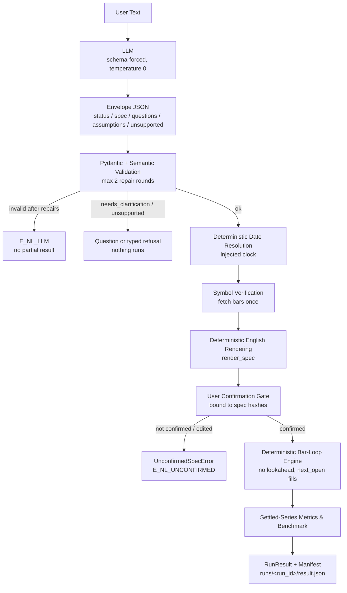

# nlbt

**The LLM translates, it never calculates, and every result is reproducible.**

Historical simulation only; not investment advice.

`nlbt` is a natural-language trading strategy backtester. You describe a
strategy in plain English; nlbt turns it into a validated JSON `StrategySpec`,
renders back exactly what will run (in deterministic English, with every
assumption disclosed), makes you confirm it, then backtests it with a
deterministic Python engine and reports auditable metrics, a trade log and a
run manifest.

The division of labour is strict (ROADMAP.md §0.3, principles C1–C5):

- **The LLM only translates.** It never computes numbers, never simulates
  trades and never writes code that gets executed. Its output must pass a
  JSON Schema, pydantic validation and semantic validation (with at most 2
  repair rounds) before anything runs.
- **Every number is produced by tested code** and is traceable to the run
  manifest: fees, slippage, fills, metrics and the benchmark all come from the
  same deterministic engine.
- **Fail loudly.** Unknown, unsupported or ambiguous input becomes a typed
  error or a clarifying question — never a silent guess.

## How it works

1. **Plain-English strategy text** (CLI `nlbt ask`, or the Streamlit UI).
2. **Schema-forced LLM translation** to a JSON *envelope* (`status`, `spec`,
   `questions`, `assumptions`, `unsupported`, `period_expression`) at
   temperature 0 against the generated `StrategySpec` JSON Schema.
3. **Validation chain:** pydantic model → semantic validator → deterministic
   gates, with the exact errors fed back to the model for at most **2 repair
   rounds** before `E_NL_LLM` is raised (no partial spec is ever returned).
4. **Deterministic date resolution** — relative phrasing ("last 3 years") is
   resolved to ISO dates in code with an injected clock, never by the model.
5. **Symbol verification** — bars are actually fetched for the parsed ticker;
   no data → clarification, never an invented symbol.
6. **Deterministic English rendering** of the validated spec (`render-spec`)
   so the user sees exactly what will run.
7. **User confirmation gate (Gate 7)** — an unconfirmed (or edited-after-
   confirmation) spec cannot run; the confirmation is bound to the logic and
   full spec hashes.
8. **Deterministic bar-loop engine** on the same bars that were verified
   (exactly one provider fetch per confirmed run).
9. **Settled-series metrics & benchmark**, warnings surfaced, then a
   **`RunResult` + manifest** (`runs/<run_id>/result.json`).



## Quick start

Requirements: Python **3.14** and [uv](https://docs.astral.sh/uv/)
(`pip install uv`).

```bash
uv sync
```

Run a JSON spec (no LLM involved — this path sends nothing over the network):

```bash
uv run nlbt run tests/fixtures/spec/cli_golden.json \
  --data-csv tests/fixtures/csv/demo_spy_daily.csv --no-persist
```

Ask in plain English (interactive confirmation; `--yes` confirms without prompting):

```bash
uv run nlbt ask "Buy SPY when RSI(14) is below 30, sell when RSI(14) is above 70, and use a 5% stop loss from 2024-01-02 to 2025-12-31." \
  --data-csv tests/fixtures/csv/demo_spy_daily.csv
```

Recorded Demo Mode (offline replay of recorded LLM responses — no live model
call for the translation):

```bash
# Recorded fixtures are keyed to the default model id: leave NLBT_LLM_MODEL unset.
# An unreachable endpoint + NLBT_LLM_DEMO=1 makes the client replay the matching
# recording (labelled "[nlbt][DEMO] ..." on stderr, llm_source="recorded-demo").
NLBT_LLM_DEMO=1 NVIDIA_API_KEY=unused NLBT_LLM_BASE_URL=http://127.0.0.1:9/v1 \
  uv run nlbt ask "Buy SPY when RSI(14) is below 30, sell when RSI(14) is above 70, and use a 5% stop loss from 2024-01-02 to 2025-12-31." \
  --data-csv tests/fixtures/csv/demo_spy_daily.csv --yes --no-persist
```

Launch the Streamlit UI:

```bash
uv run streamlit run src/nlbt/ui/app.py
```

In the sidebar choose the data source (`Bundled Demo CSV (offline)`), the LLM
mode (`Recorded Demo Mode (offline)` or `Live NIM (with Recorded Demo
fallback)`) and one of the five built-in demo prompts, then **Interpret →
Confirm Spec → Run Confirmed Backtest**. See `docs/demo_script.md` for the
scripted demo.

Other commands:

| Command | What it does |
|---|---|
| `mingw32-make all` | ruff check + format check + mypy strict + pytest with coverage (the task gate) |
| `mingw32-make lint` / `type` / `test` | each gate on its own |
| `uv run nlbt validate-spec SPEC.json` | schema + semantic validation |
| `uv run nlbt render-spec SPEC.json` | deterministic English rendering |

(On Windows without GNU `make` on PATH, `mingw32-make` is equivalent.)

## Execution & fill model (summary)

- **No lookahead.** Signals are computed only from data at or before bar `t`
  (`<= t`); entries and exits **fill at the next bar's open** (`fill =
  next_open`, the only v1 convention).
- **Costs on both sides:** adverse slippage plus fees per side — defaults are
  **5 bps fee + 5 bps slippage** (configurable per spec: `fee_bps`,
  `slippage_bps`, `fixed_fee`).
- **Intrabar risk exits**, checked in bar order: stop-loss, take-profit,
  **ratcheted trailing stop** and `max_holding_bars` (see
  `docs/limitations.md` for the known take-profit/trailing-stop precedence
  caveat, OQ-0063).
- **End of data:** a position still open after the last bar is force-closed at
  the last close with slippage (`exit_reason="end_of_data"`), and metrics are
  computed on the resulting *settled* equity series.
- The benchmark is a buy-and-hold run through the **same engine**, same data,
  same costs, so the comparison is apples to apples (details and caveats in
  `docs/metrics.md`).

## Metric definitions (summary)

Full definitions live in [`docs/metrics.md`](docs/metrics.md). Highlights:

- All metrics are computed on the **settled equity series** (last value
  replaced by realized `final_equity` after a forced `end_of_data` close).
- **Undefined ⇒ `null` + a surfaced warning — never `0`, `NaN` or `inf`**
  (zero variance ⇒ Sharpe null; zero drawdown ⇒ Calmar null; fewer than 2 bars
  ⇒ all return metrics null; ...). The CLI prints `n/a` for those.
- **`rf` is always reported** as `risk_free_rate` next to Sharpe.
- **Profit factor is NET basis:** `sum(net_pnl > 0) / abs(sum(net_pnl < 0))`,
  `null` + warning when there are no losses.
- `bars_per_year` is derived from the data frequency (or explicitly supplied),
  never silently hardcoded.

## The trust story

Numbers below come from a full run of `uv run pytest --cov
--cov-report=term-missing` on 2026-10-29 (`mingw32-make all` runs the same
suite):

```
1025 passed, 1 skipped, 3 deselected in 227.48s (0:03:47)
TOTAL                                   3701    342   1032    122  88.3%
```

- **1,025 passing tests** (plus 1 skipped, 3 deselected), **88.3 %** line +
  branch coverage overall; `engine/backtest.py` 99.6 %, `engine/risk.py`
  95.6 %, `metrics/` 94.3 %/100 %.
- **Hypothesis property tests** for all engine invariants **I1–I14**
  (`tests/property/test_engine_invariants.py`).
- **No-lookahead defences:** truncation and future-poison tests for every
  indicator and the full engine (`tests/property/test_indicator_truncation.py`,
  `tests/property/test_engine_lookahead.py`), with a **red-on-leak canary
  test** that fails loudly if the leak detector stops working (Gate 2/Gate 4).
- **Differential tests against an independent oracle** — `backtesting.py`
  0.6.6 — scenarios **S1–S6** in `tests/differential/`, every difference
  explained in writing in [`docs/differential_notes.md`](docs/differential_notes.md)
  (Gate 4 requires zero unexplained differences).
- **Byte-identical determinism:** same spec + same data + same code ⇒
  byte-identical result; `--json` stdout is byte-identical to the stored
  `result.json`.
- **Golden CLI integration tests** (`tests/golden/`, `tests/integration/`);
  regenerating a golden file requires an explicit owner-approved change
  (ROADMAP §8.4 — agents may not "update goldens" to go green).
- **12 indicators** in the registry (`adx, atr, bbands, ema, highest, lowest,
  macd, obv, roc, rsi, sma, stoch`), each with hand-vector + oracle + warm-up
  + truncation tests; the schema, prompt, docs and validator are all generated
  from that single registry (C7).

Engine speed, from the committed benchmark output
(`benchmarks/last_run_output.txt`, 2026-10-18, Windows 11 / Python 3.14.4):

```
bars=2500    time=0.116 s  (21,528 bars/s)
bars=100000  time=4.514 s  (22,154 bars/s)
```

## Privacy & LLM provider

- **What leaves your machine:** only the strategy text (the message you typed)
  is sent to the configured OpenAI-compatible endpoint for `nlbt ask` /
  Live-LLM UI mode. Prices, results and the manifest stay local.
- **Default endpoint:** NVIDIA NIM, `https://integrate.api.nvidia.com/v1`
  (`NLBT_LLM_BASE_URL` overrides it); the model id comes from `NLBT_LLM_MODEL`
  and is never hard-coded.
- **Trial caveat:** NIM access is under the **NVIDIA API Trial Terms of
  Service** — evaluation/development use only, not for production trading.
- **No-LLM mode:** `nlbt run` with a JSON spec performs **zero network calls**
  — no LLM call, and data comes from `--data-csv` or the parquet cache.
- **API key** is read from the `NVIDIA_API_KEY` environment variable or the
  gitignored `nlbt/.env` (never exported, never printed), and key-like values
  are redacted from logs and exceptions.

## Known limitations

Open questions and deferred scope are inventoried honestly in
[`docs/limitations.md`](docs/limitations.md) (the owner still has to sign it —
Gate 10). Highlights: long-only v1 (shorts gated), daily bars only, one symbol
per run, take-profit is currently checked before the trailing stop on a shared
bar (OQ-0063), no `nlbt replay` yet.

## Project layout

```text
nlbt/
├── src/nlbt/          library: data, indicators, spec, engine, metrics, nl, results, ui, cli
├── tests/             unit / property / integration / golden / differential
├── docs/              metrics.md, cli.md, limitations.md, demo_script.md, differential_notes.md, adr/
├── benchmarks/        engine_timing.py + last_run_output.txt
├── ROADMAP.md (repo root)   plan, contracts and gate checklists
└── Makefile           mingw32-make all = lint + type + test
```

## Not financial advice

This project produces historical simulations, not predictions. **Historical
simulation only; not investment advice.**
