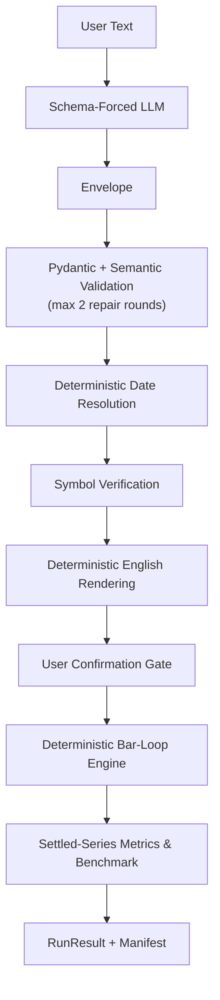

# nlbt

**The LLM translates, it never calculates, and every result is reproducible.**

Historical simulation only; not investment advice.

## Overview

`nlbt` is a natural-language trading strategy backtester:

**plain-English strategy → schema-forced LLM translation to a validated JSON
`StrategySpec` → deterministic back-translation to English + explicit user
confirmation gate → deterministic Python backtest engine → auditable metrics,
trade log, and run manifest.**

The division of labour is strict (ROADMAP.md §0.3, principles C1–C5):

- **The LLM only translates.** It never computes a number, never simulates a
  trade and never emits code that gets executed. Its output must pass a JSON
  Schema, pydantic validation and semantic validation (at most **2 repair
  rounds**) before anything runs.
- **Every number comes from tested code** and is traceable through the run
  manifest: fees, slippage, fills, metrics and the benchmark all come from the
  same deterministic engine.
- **Fail loudly.** Ambiguous, unsupported or unconfirmed input stops the
  pipeline with a clarifying question or a typed error — never a silent guess.
  Nothing runs until the user confirms the exact spec that will run.

## Quick start

Requirements: Python **3.14** and [uv](https://docs.astral.sh/uv/)
(`pip install uv`).

Install:

```bash
uv sync
```

Run a JSON spec (no LLM — this path makes zero LLM calls):

```bash
uv run nlbt run tests/fixtures/spec/cli_golden.json --data-csv tests/fixtures/csv/cli_daily.csv --no-persist
```

Ask in plain English (offline recorded demo mode):

```bash
NLBT_LLM_DEMO=1 uv run nlbt ask "Buy SPY when RSI(14) is under 30 and sell when RSI(14) is above 70, with a 5% stop loss, from 2024-01-02 to 2025-12-31." --data-csv tests/fixtures/csv/demo_spy_daily.csv --yes --no-persist
```

> Verified caveat: the CLI replays a recording only when the endpoint is
> **unreachable** and the prompt matches one of the five built-in demo prompts
> (`src/nlbt/ui/demo_cases.py`). The command above therefore makes a live call
> if your key and endpoint are configured. For a guaranteed offline replay,
> use demo prompt 2's exact wording, a placeholder key (so the gitignored
> `nlbt/.env` is never read) and an unreachable port — this is the form
> verified in [`docs/demo_script.md`](docs/demo_script.md):
>
> ```bash
> NLBT_LLM_DEMO=1 NVIDIA_API_KEY=unused NLBT_LLM_BASE_URL=http://127.0.0.1:9/v1 \
>   uv run nlbt ask "Buy SPY when RSI(14) is below 30, sell when RSI(14) is above 70, and use a 5% stop loss from 2024-01-02 to 2025-12-31." \
>   --data-csv tests/fixtures/csv/demo_spy_daily.csv --yes --no-persist
> ```
>
> Successful replay is labelled on stderr:
> `[nlbt][DEMO] serving RECORDED LLM response -- endpoint unreachable; output is NOT from the model`.

Launch the Streamlit UI:

```bash
uv run streamlit run src/nlbt/ui/app.py
```

In the sidebar choose the data source (`Bundled Demo CSV (offline)`), the LLM
mode (`Recorded Demo Mode (offline)` or `Live NIM (with Recorded Demo
fallback)`) and one of the five built-in demo prompts, then **Interpret →
Confirm Spec → Run Confirmed Backtest**. Full walkthrough:
[`docs/demo_script.md`](docs/demo_script.md).

Other commands (details in [`docs/cli.md`](docs/cli.md)):

| Command | What it does |
|---|---|
| `uv run nlbt validate-spec SPEC.json` | schema + semantic validation |
| `uv run nlbt render-spec SPEC.json` | deterministic English rendering |
| `mingw32-make all` | ruff check + format check + mypy strict + pytest with coverage (the project gate) |

## Architecture



Anything that fails validation, cannot be resolved deterministically, is
ambiguous/unsupported, or is not confirmed stops the pipeline with a typed
error or a clarifying question — no partial result is ever executed.

## How fills & execution work

- **No lookahead.** Signals are computed only from data at or before bar `t`
  (`<= t`); entries and exits **fill at the next bar's open** (`t+1` open) —
  the only v1 fill convention.
- **Costs on both sides:** adverse slippage plus fees per side. Defaults are
  **5 bps fee + 5 bps slippage** (per spec: `fee_bps`, `slippage_bps`,
  `fixed_fee`).
- **Intrabar risk exits**, checked in bar order: stop-loss, take-profit,
  **ratcheted trailing stop** and `max_holding_bars`. (Known caveat: on a bar
  where both a take-profit and a trailing stop are reachable, take-profit is
  checked first today — OQ-0063 in [`docs/limitations.md`](docs/limitations.md).)
- **End of data:** a position still open after the last bar is force-closed at
  the **last close with slippage** (`exit_reason="end_of_data"`), and metrics
  are computed on the resulting *settled* equity series.
- The benchmark is a buy-and-hold run through the **same engine** — same data,
  same costs, same capital — so the comparison is apples to apples (caveats in
  [`docs/metrics.md`](docs/metrics.md)).

## Metric definitions summary

Full definitions: [`docs/metrics.md`](docs/metrics.md).

- All metrics are computed on the **settled equity series** (last value
  replaced by the realized `final_equity` after a forced `end_of_data` close).
- **Undefined ⇒ `null` + a surfaced warning — never `0`, `NaN` or `inf`**
  (zero variance ⇒ Sharpe null; zero drawdown ⇒ Calmar null; fewer than 2 bars
  ⇒ all return metrics null; ...). The CLI prints `n/a` for those.
- **`rf` is always reported** as `risk_free_rate`, next to Sharpe.
- **Profit factor is NET basis:** `sum(net_pnl > 0) / abs(sum(net_pnl < 0))`,
  `null` + warning when there are no losses.
- `bars_per_year` is derived from the data frequency (or explicitly supplied),
  never silently hardcoded.

More reading: [`docs/cli.md`](docs/cli.md) (commands, flags, exit codes) ·
[`docs/demo_script.md`](docs/demo_script.md) (offline demo) ·
[`docs/limitations.md`](docs/limitations.md) (honest inventory of what nlbt
does not do).

## The trust story

Numbers below are from `mingw32-make all` (`uv run pytest --cov
--cov-report=term-missing --cov-report=xml`), verified 2026-10-30:

```
1025 passed, 1 skipped, 3 deselected
TOTAL    3701    342    1032    122    88.3%
```

- **1,025 passing tests** (1 skipped, 3 deselected) and **88.3 %** combined
  line + branch coverage overall — with the three core packages above the
  90 % target: **`engine` 92.87 %, `metrics` 96.53 %, `spec` 92.40 %,
  92.95 % combined across all three.**
- **Hypothesis property tests** on the engine invariants **I1–I14**
  (`tests/property/test_engine_invariants.py`) — counterexamples shrink, they
  are never seeded away.
- **No-lookahead defences:** truncation and future-poison lookahead tests for
  every indicator and for the full engine
  (`tests/property/test_indicator_truncation.py`,
  `tests/property/test_engine_lookahead.py`), plus a **red-on-leak canary
  test** that fails loudly if the leak detector itself ever stops working.
- **Differential tests against an independent tool:** scenarios **S1–S6**
  compared trade-by-trade and row-by-row against **`backtesting.py 0.6.6`**
  (`tests/differential/`); every difference is written up in
  [`docs/differential_notes.md`](docs/differential_notes.md) and unexplained
  differences block the gate.
- **Byte-identical determinism:** same spec + same data + same code ⇒
  byte-identical `result.json` — verified across a **fresh `git clone`**
  (`uv sync` in the clone, same command, identical result after the documented
  volatile fields are dropped).
- **Golden CLI integration tests** (`tests/golden/`,
  `tests/integration/test_cli.py`); regenerating a golden file requires an
  explicit owner-approved PR — agents may not "update goldens" to go green.
- **12 indicators** in the registry (`adx, atr, bbands, ema, highest, lowest,
  macd, obv, roc, rsi, sma, stoch`), each with hand-vector + oracle + warm-up +
  truncation tests; the schema, prompt, docs and validator are all generated
  from that single registry (C7).

## Privacy & LLM provider

- **What leaves your machine:** only the strategy text you typed is sent to
  the configured OpenAI-compatible endpoint, and only on the `nlbt ask` /
  Live-LLM UI path. Prices, results and the manifest stay local.
- **Default endpoint:** NVIDIA NIM `https://integrate.api.nvidia.com/v1`
  (`NLBT_LLM_BASE_URL` overrides it); the model id comes from `NLBT_LLM_MODEL`
  and is never hard-coded.
- **Trial caveat:** NIM access is under the **NVIDIA API Trial Terms of
  Service** — evaluation/development use only, **not for production**.
- **No-LLM mode:** `nlbt run` with a JSON spec makes **zero LLM calls** —
  nothing leaves the machine (data comes from `--data-csv` or the local
  parquet cache).
- **API key:** read from the `NVIDIA_API_KEY` environment variable or the
  gitignored `nlbt/.env`; never printed, and key-like values are redacted from
  logs and exceptions.

## Known limitations

Open questions and deferred scope are inventoried honestly in
[`docs/limitations.md`](docs/limitations.md). Highlights: long-only v1
(shorts gated), daily bars only, one symbol per run, take-profit currently
checked before the trailing stop on a shared bar (OQ-0063), `nlbt replay` not
built yet. Known limitations are published, not buried.

## Project layout

```text
nlbt/
├── src/nlbt/          library: data, indicators, spec, engine, metrics, nl, results, ui, cli
├── tests/             unit / property / integration / golden / differential
├── docs/              metrics.md, cli.md, limitations.md, demo_script.md, differential_notes.md, adr/
├── benchmarks/        engine_timing.py + last_run_output.txt
├── ROADMAP.md (repo root)   plan, contracts and gate checklists
└── Makefile           mingw32-make all = lint + type + test
```

## Disclaimer

This project produces historical simulations, not predictions. **Historical
simulation only; not investment advice.**
